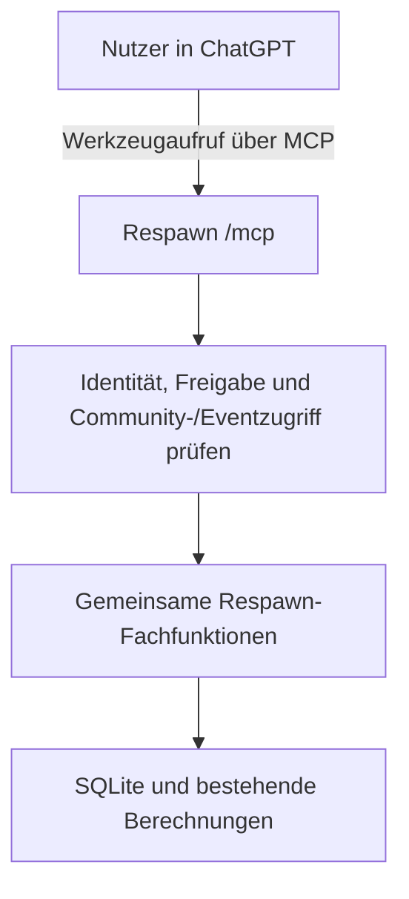

# Respawn in ChatGPT – Produkt- und Umsetzungskonzept

Stand: 15. November 2026. Dieses Konzept beschreibt das Ziel und den priorisierten Umfang.
Der konkrete implementierte Umfang, Betriebsgrenzen und die Einrichtung sind in
[ChatGPT/MCP](../chatgpt-mcp.md) dokumentiert. Spätere Erweiterungen in diesem Konzept gelten
nicht automatisch als bereits vorhandene Funktionen.

## 1. Ziel und Empfehlung

Respawn erhält eine optionale ChatGPT-Anbindung für Überblick, direkte Statistikfragen, Spielplanung und LAN-Rückblicke. Nutzer können Fragen zu ihrer Veranstaltung stellen, Kennzahlen gezielt auswerten und Vorschläge aus den vorhandenen Daten erstellen lassen. Die Weboberfläche bleibt der direkte Zugang für den laufenden Spielbetrieb.

Der erste Nutzerkreis sind ein bis zwei Organisatoren. Nicht alle Teilnehmenden müssen ChatGPT verwenden oder ein zusätzliches Konto einrichten. Für eine LAN mit ungefähr 15 Personen ist der Nutzen besonders dort zu erwarten, wo mehrere Ansichten zusammengeführt werden müssen: Wer ist online, welche Spiele passen zur Gruppengröße, wie lassen sich Teams bilden und was waren die Highlights?

Empfehlung: einen privaten MCP-Anschluss mit sieben regulären Werkzeugen sowie zwei getrennten Admin-Werkzeugen für die Bereinigung bauen. Direkte Statistik- und Nutzungsauswertung ist ein Kernbestandteil des MVP. Die erste Version liest Daten und erstellt unverbindliche Teamvorschauen. Als ausdrücklich vorgesehene Admin-Funktion kommt die kontrollierte Bereinigung alter Match-Auslosungen ohne Ergebnis hinzu. Weitere schreibende Funktionen folgen nach dem Praxistest.

## 2. Ausgangslage im Projekt

Ausgangspunkt ist der vorhandene Respawn-Server mit seinen Fachrouten unter `server/src/`.

| Vorhandene Grundlage | Konsequenz für das Konzept |
|---|---|
| Node.js-/TypeScript-Server mit Express, SQLite und Socket.IO | Ein kleines Integrationsmodul passt zum bestehenden Aufbau. |
| Fachrouten für Live-Status, Spiele, Skills, Teams, Votes, Turniere und Statistiken | Die erforderlichen Daten sind weitgehend vorhanden. |
| Persönliche Browser-Sessions als HttpOnly-Cookie | Für ChatGPT wird zusätzlich eine geeignete delegierte Anmeldung benötigt. Browser-Cookies werden nicht kopiert. |
| Community-, Event- und Rollenprüfungen | Jede Werkzeugausführung muss dieselben fachlichen Grenzen durchsetzen. |
| Verborgene Zwischenstände bei Votes und teilweise noch nicht veröffentlichte Punkte | Die Anbindung darf diese Informationen auch durch Zusammenfassungen nicht vorzeitig offenlegen. |
| `POST /api/matchmaking` speichert und veröffentlicht Auslosungen | Diese Route eignet sich nicht für eine unverbindliche Vorschau. |
| Bestehende Funktion `balanceTeams` und gemeinsame Berechnungen für Auswertungen | Teams und Zahlen werden durch Respawn berechnet; ChatGPT formuliert und erklärt die Ergebnisse. |

Maßgebliche Einstiegspunkte sind `server/src/routes/index.ts`, `server/src/sessions.ts`, `server/src/groupAuthorization.ts`, `server/src/routes/matchmaking.ts`, `server/src/matchmaking.ts`, `server/src/routes/votes.ts`, `server/src/routes/eventDatePolls.ts`, `server/src/routes/leaderboard.ts`, `server/src/routes/export.ts`, `server/src/routes/stats.ts`, `server/src/routes/analytics.ts`, `server/src/playtime.ts`, `server/src/gameStats.ts` und `server/src/betting.ts`.

## 3. Nutzererlebnis

### Überblick während der LAN

**Nutzer:** „Was läuft gerade auf unserer LAN?“

**Verhalten:** ChatGPT lädt das festgelegte Event und dessen aktuellen Status. Die Antwort nennt laufende Spiele, offene Abstimmungen und Turniere mit nächsten offenen Begegnungen, soweit die Daten vorhanden sind. Sie zeigt Event, Datenstand und einen Link zur passenden Respawn-Ansicht.

Ein vom Agenten gemeldetes Spiel bedeutet nicht automatisch, dass die Person verfügbar oder aktiv am PC ist. Der Assistent unterscheidet zwischen gemeldetem Spiel, manuellem Status, veralteter Meldung und ausdrücklich zugesagter Teilnahme.

### Passendes Spiel finden

**Nutzer:** „Wir sind acht Leute. Was könnten wir spielen? Keine Shooter.“

**Verhalten:** Respawn liefert geeignete Einträge aus dem eigenen Spielekatalog, einschließlich vorhandener Bewertungen und Kapazitätsangaben. ChatGPT begründet eine kleine Auswahl und kennzeichnet fehlende Informationen. Sind Genre, Installationsstatus oder Dauer nicht im Datenbestand enthalten, werden sie nicht als bekannt behauptet. Nutzervorgaben können fehlende Metadaten ergänzen.

### Teams vorbereiten

**Nutzer:** „Schlage für diese zehn Spieler zwei ausgeglichene CS-Teams vor.“

**Verhalten:** Namen werden auf eindeutige Spieler-IDs aufgelöst. Bei Mehrdeutigkeit wird nachgefragt. Respawn berechnet eine Vorschau mit der vorhandenen Balancierung und zeigt Teams, Bewertungsgrundlage und fehlende Ratings. Es entstehen weder Historieneinträge noch Pushs, öffentliche Auslosungen oder Orga-Punkte.

Die vorhandene Option zur Berücksichtigung von Sitznachbarn wird mit ihrer bestehenden Bedeutung übernommen und nur bei expliziter Auswahl angewendet. „Online“ wird nicht automatisch mit „nimmt teil“ gleichgesetzt.

### Statistiken direkt abfragen

**Nutzer:** „Was wurde am meisten gespielt, und wie viele Auslosungen gab es?“

**Verhalten:** ChatGPT ruft konkrete Kennzahlen ab und nennt Zeitraum, Event und Zählweise. „Am meisten gespielt“ wird standardmäßig als erfasste Spielerstunden interpretiert und entsprechend beschriftet; andere Sichtweisen sind als Nachfrage oder auf ausdrücklichen Wunsch abrufbar. „Wie viele Auslosungen?“ meint standardmäßig gespeicherte automatische Auslosungen; Drafts, Rematches und tatsächlich erfasste Matches werden getrennt ausgewiesen. ChatGPT zählt keine unvollständige Historienseite aus.

Mögliche Folgefragen sind „Nur am Samstag“, „Nur CS“, „Nach Teilnehmerzahl sortieren“ oder „Wie viele davon haben ein Ergebnis?“. Unterstützte Filter werden auf die serverseitige Berechnung angewendet. Ein fehlender Filter wird nicht stillschweigend ignoriert.

### Nutzung und Beteiligung auswerten

**Nutzer:** „Wie viele Umfragen hatten wir, wie viele Leute haben mitgemacht und wie viele Match-Auslosungen sind noch ohne Ergebnis?“

**Verhalten:** Der Assistent zeigt Umfragen nach Typ und Status, eindeutige Antwortende je Umfrage und insgesamt sowie gespeicherte Match-Auslosungen ohne Ergebnis. Er kann Alter und Spiel der offenen Auslosungen aufschlüsseln. Stimmen oder Bewertungen mehrerer Optionen werden nicht als mehrere Personen gezählt. Allgemeine Eventumfragen und Spielabstimmungen sind unterscheidbar; eine reine Spielstatistik deckt die Frage nach der Nutzung des gesamten Tools nicht ab.

### Alte Match-Auslosungen aufräumen

**Admin:** „Lösche alle Match-Auslosungen ohne Ergebnis, die älter als sieben Tage sind.“

**Verhalten:** Respawn erstellt einen auf Community und Event begrenzten Löschplan mit festem Stichtag, betroffenen Auslosungen und geschützten Einträgen. Der Admin prüft und bestätigt ihn in Respawn mit der bestehenden erneuten Anmeldung. Die Ausführung löscht ausschließlich die bestätigte, weiterhin berechtigte Auswahl. Abschnitt 8 beschreibt die genaue Abgrenzung.

### Rückblick erstellen

**Nutzer:** „Schreib einen Rückblick zur LAN mit Siegern und Highlights.“

**Verhalten:** Respawn liefert freigegebene Ranglisten, Spielzeiten, abgeschlossene Turniere und verfügbare Awards. ChatGPT erstellt daraus einen Textentwurf. Fehlende oder noch nicht veröffentlichte Ergebnisse werden benannt. Spielzeit wird nicht ohne entsprechende Datengrundlage als aktive Spielzeit bezeichnet. Der Text wird zunächst nur im Chat ausgegeben.

## 4. Umfang des MVP

Die folgenden Namen und Verträge sind vorgeschlagene neue Werkzeuge, keine bereits vorhandene API. Die ersten sieben sind die regulären MVP-Werkzeuge; die letzten beiden sind ausschließlich für berechtigte Community-Admins vorgesehen.

| Werkzeug | Eingaben | Ergebnis und Grenze |
|---|---|---|
| `get_context` | Keine fachlichen IDs nötig | Verbundenes Profil, festgelegte Community, Event, freigeschaltete Funktionen und erlaubte Werkzeuge. |
| `get_overview` | Optional begrenzte Ergebnisanzahl | Live-Status, Aktualität und kompakte Veranstaltungslage. Keine dauerhafte Überwachung. |
| `get_game_options` | Teilnehmerzahl, optional explizite Spieler-IDs und vorhandene Filter | Spielekatalog und relevante Bewertungsaggregate; fehlende Eignungsdaten bleiben ausdrücklich unbekannt. |
| `get_competitions` | Optional Typ und Status | Turniere, offene Begegnungen und sichtbarer Vote-Status. Verborgene Vote-Zwischenstände werden serverseitig entfernt. |
| `get_statistics` | Kennzahl, optional Zeitraum, Spiel, zugänglicher Spieler, Gruppierung und begrenzte Top-N-Auswahl | Serverseitig berechnete Kennzahlen mit Einheit, Definition, Filtern, Datenstand und Vollständigkeit. Keine freie SQL-Abfrage. |
| `get_event_summary` | Optional Zeitraum innerhalb des freigegebenen Events | Freigegebene Rangliste, aggregierte Spielzeit, Awards und Turnierausgänge; kein vollständiger Datenbank- oder Kommunikationsexport. |
| `preview_teams` | Spiel-ID, explizite Spieler-IDs, Teamanzahl und optional vorhandene Sitznachbaroption | Unverbindliche Teamaufteilung ohne Veränderung des fachlichen Eventzustands. |
| `preview_draw_cleanup` | Alter als positive Zahl mit Einheit Stunden/Tage; optional Spiel und ausdrücklich ausgewählte Quellen | Admin-Vorschau: fester Stichtag, löschbare IDs und Anzahl, geschützte Einträge mit Gründen, Ablaufzeit und Löschplan-ID. Noch keine Löschung. |
| `execute_draw_cleanup` | Löschplan-ID und technisch nachgewiesene Admin-Freigabe; Wiederholungsschlüssel | Führt ausschließlich den bestätigten, unveränderten und erneut geprüften Plan aus. Keine frei übergebbare Liste zusätzlicher IDs. |

Alle Ergebnisse enthalten Community- und Event-ID, einen UTC-Datenstand sowie gegebenenfalls Hinweise auf unvollständige oder ausgeblendete Daten. Fachliche Werte werden strukturiert geliefert. Die Erklärung im Chat kann variieren, die zugrunde liegenden Zahlen müssen mit Respawn übereinstimmen.

Das MVP hat keine eigene Oberfläche innerhalb von ChatGPT. Strukturierte Antworten, kleine Tabellen und geprüfte Links zur Weboberfläche reichen für den Pilotbetrieb aus. Für die irreversible Admin-Bereinigung ist ein konkreter Prüf- und Bestätigungsdialog in der Respawn-Adminoberfläche vorgesehen.

### Statistikkatalog und typische Fragen

| Bereich | Beispielfragen | Kennzahlen |
|---|---|---|
| Beliebteste Spiele | „Was wurde am meisten gespielt?“ / „Welches Spiel hatte die meisten Mitspieler?“ | Erfasste Spielerstunden je Spiel, eindeutige Spieler, erfasste Sessions; jede Rangfolge nennt ihre Bezugsgröße. |
| Auslosungen und Teams | „Wie viele Auslosungen gab es?“ / „Für welches Spiel wurde am häufigsten ausgelost?“ | Automatische Auslosungen, abgeschlossene Captain-Drafts und Rematches getrennt; jeweils insgesamt, nach Spiel und mit/ohne verknüpftes Ergebnis. |
| Matches | „Wie viele Matches haben wir eingetragen?“ / „Wer hat am häufigsten gewonnen?“ | Eindeutige gespeicherte Matches, Siege, Remis soweit explizit erfasst, Ergebnisse ohne Sieger; Turnierspiele sind eine ausgewiesene Teilmenge. |
| Turniere | „Wie viele Turniere liefen und wie viele sind fertig?“ | Anzahl nach tatsächlichem Status, Spiel und Format; abgeschlossene Turniere mit freigegebenen Siegern. |
| Spielzeiten | „Wie lange wurde CS gespielt?“ / „Wer hat die meiste erfasste Spielzeit?“ | Erfasste Laufzeit, längste Session und optional getrennt aktive Spielzeit mit Hinweis auf Tracking-Abdeckung. |
| Gleichzeitiges Spielen | „Wann waren die meisten Leute gleichzeitig in CS?“ | Zeitverlauf und Spitzenwert; exakter Spitzenwert oder Zeitraster-Aggregat werden ausdrücklich unterschieden. |
| Abstimmungen | „Wie viele Spielabstimmungen gab es?“ / „Was hat am häufigsten gewonnen?“ | Runden nach Status, Sieger abgeschlossener und sichtbarer Runden, Beteiligung nur soweit freigegeben. |
| Allgemeine Umfragen und Beteiligung | „Wie viele Umfragen gab es mit wie vielen Leuten?“ / „Welche Umfrage hatte die höchste Beteiligung?“ | Eventumfragen getrennt nach Thema und Antwortmodus, Umfragenzahl, eindeutige Antwortende je Umfrage und insgesamt, durchschnittliche Beteiligung, Umfragen ohne Antworten und Beteiligungsquote bei belastbarem Nenner. |
| Match-Auslosungen ohne Ergebnis | „Wie viele Auslosungen haben noch kein Ergebnis?“ / „Wie viele davon sind älter als sieben Tage?“ | Anzahl und Anteil an gespeicherten Auslosungen, nach Quelle, Spiel und Altersklasse; Alter der ältesten, verknüpfte beziehungsweise geschützte Einträge und aktuell bereinigbare Teilmenge. |
| Weitere Funktionsnutzung | „Wie viele Essensbestellungen gab es?“ / „Wie viele Checklisten-Aufgaben wurden erledigt?“ | Soweit gespeichert und zugänglich: Bestellrunden, eindeutige Bestellende, Positionen; Aufgaben nach Zustand; Durchsagen und abgeschlossene Arcade-Runden. Jede Kennzahl benennt Quelle und Abdeckung. |
| Gemeinsame Ergebnisse | „Wer hat oft zusammen gespielt?“ / „Welches Duo gewann oft?“ | Gemeinsame Matches, gemeinsame Siege und nachvollziehbare Mindeststichprobe bei Quoten. Keine Behauptung über tatsächliche gemeinsame Spielzeit ohne passende Daten. |

Die Basisauswertungen für Spiele, Auslosungen einschließlich fehlender Ergebnisse, Matches, Turniere, Spielzeit sowie Umfragen und deren Beteiligung gehören in das MVP. Die weiteren Nutzungskennzahlen bilden einen priorisierten Erweiterungskatalog. Vertiefungen wie Duo-Ranglisten, Zeitverläufe oder Vote-Vergleiche folgen nur auf derselben klar definierten Datenbasis und können nach dem Pilot ergänzt werden. Nicht jede technisch formulierbare Frage wird als bereits unterstützte Kennzahl angeboten.

### Beteiligung richtig zählen

„Umfragen“ umfasst allgemeine Eventumfragen, beispielsweise zu Termin, Ort oder eigenen Themen, sowie getrennt ausgewiesene Spielabstimmungen. Summen addieren die jeweiligen Objekte genau einmal; einzelne Antwortoptionen, Fragenoptionen oder Datensätze einer Punktebewertung sind keine eigenen Umfragen. Eine Stichwahl ist eine eigene Abstimmungsrunde und wird als solche ausgewiesen. Eine thematische Zusammenfassung mehrerer Runden wird nur bei vorhandener eindeutiger Verknüpfung angeboten.

Pro Umfrage werden, soweit vorhanden und sichtbar, ermittelt:

- Typ, Thema, Antwortmodus, tatsächlicher Status und Erstellzeitpunkt.
- Zahl der berechtigten beziehungsweise eingeladenen Personen, sofern für diese Runde zuverlässig feststellbar.
- Zahl eindeutiger Personen mit irgendeiner gespeicherten Antwort und gesondert Zahl vollständiger, gültiger Antworten nach den bestehenden Fachregeln.
- Beteiligungsquote aus vollständigen Antworten und passendem Teilnehmerkreis; bei fehlendem historischem Teilnehmerkreis „nicht bestimmbar“ statt einer Quote gegen die heutige Mitgliederzahl.
- Fehlende Antworten als Differenz nur bei belastbarem Teilnehmerkreis. Unvollständige und vollständige Antworten werden nicht vermischt.

Über mehrere Umfragen werden Umfragenzahl, eindeutige Personen über alle Runden und Antwortteilnahmen getrennt angezeigt: Dieselbe Person in fünf Umfragen ergibt eine eindeutige Person und fünf Antwortteilnahmen. Der einfache Durchschnitt pro Umfrage wird als solcher bezeichnet; eine gewichtete Gesamtquote nutzt die Summe der passenden Nenner. Bei null Berechtigten ist die Quote nicht definiert. Änderungen einer Antwort erhöhen die Personenanzahl nicht.

Umfragen ohne Antworten gehören ausdrücklich in die Gesamtzahl und in entsprechend beschriftete Durchschnittswerte. Eine Historienansicht, die solche Runden ausblendet, ist deshalb keine vollständige Aggregationsquelle. Sichtbarkeit und Anonymität gelten auch für Beteiligungszahlen; wenn die bestehende Regel einen Wert verbirgt, bleibt dieser unbekannt und darf nicht aus anderen Summen abgeleitet werden. Antworten und Identitäten werden nicht aus anonymen Umfragen rekonstruiert.

Ein Nutzungsbericht fasst die verfügbaren Bereiche tabellarisch zusammen. Er erfindet keine Seitenaufrufe, Klickzahlen, Verweildauer oder „aktive Nutzer“, wenn diese nicht erfasst werden. Aus erstellten Objekten und beantworteten Umfragen lässt sich konkrete dokumentierte Nutzung ableiten, aber keine vollständige Besuchsstatistik. Zusätzliche Telemetrie ist ein separates Vorhaben.

### Definitionen und Datenqualität

- **Spielerstunden:** Summe der erfassten Laufzeiten pro Spieler und Spiel. Zehn Personen mit je zwei Stunden ergeben zwanzig Spielerstunden. Das sind nicht zwanzig Stunden Veranstaltungsdauer. Parallel laufende Spiele können auch die spielübergreifende Summe einer Person erhöhen; diese Summe ist keine bereinigte Anwesenheitszeit.
- **Aktive Spielzeit:** Nur als eigener Messwert mit vorhandener Opt-in-Erfassung. Fehlendes Aktivitätstracking bedeutet „nicht erfasst“ und nicht „nicht gespielt“. Vergleiche müssen unterschiedliche Tracking-Abdeckung kenntlich machen.
- **Session:** Ein gespeicherter Tracking-Abschnitt, kein Match. Unterbrechungen oder Neustarts können mehrere Sessions erzeugen.
- **Auslosung:** Für die Standardfrage werden reguläre automatische Auslosungen gezählt. Der aktuelle Datenbestand unterscheidet diese über `source IS NULL` von `draft` und `rematch`; eine Turnierzuordnung wird als zusätzliches Merkmal ausgewiesen und nicht doppelt gezählt. Die bestehende Statistik `draws.total` zählt dagegen sämtliche gespeicherten Teamaufstellungen. Diese Sammelzahl wird als „Teamaufstellungen gesamt“ beschriftet und nicht ungeprüft als Zahl automatischer Auslosungen übernommen.
- **Neuauslosungen:** Gespeicherte wiederholte automatische Auslosungen zählen jeweils mit. Eine gesonderte Frage „Wie oft wurde neu ausgelost?“ ist nur beantwortbar, wenn Ersatzbeziehungen zuverlässig gespeichert sind; sie werden nicht aus gleichen Teilnehmern oder Zeitabständen geraten. Chat-Vorschauen zählen nie mit.
- **Mit Ergebnis:** Eine Verknüpfung zu einem gespeicherten Ergebnis ist nachweisbar. Ohne Ergebnis bedeutet „kein Ergebnis erfasst“, nicht automatisch „wurde nie gespielt“.
- **Ohne Ergebnis und Alter:** Für die neue Kennzahl ist `match_id IS NULL` maßgeblich; ein gespeichertes Remis oder Ergebnis ohne Sieger ist kein fehlendes Ergebnis. Alter wird aus `generated_at` und einem einheitlichen Serverzeitpunkt berechnet. Der Anteil ohne Ergebnis verwendet denselben Quellen-, Event- und Spielfilter wie sein Nenner. „Ohne Ergebnis“ ist noch keine Löschfreigabe; Schutzverknüpfungen werden separat geprüft.
- **Matches:** Eindeutige Ergebnisdatensätze werden einmal gezählt. Verknüpfte Teamaufstellungen oder Turnieransichten erzeugen keinen zweiten Matchzählpunkt. Ein Ergebnis ohne Sieger wird nicht automatisch als Remis interpretiert.
- **Bestes Duo:** Die vorhandene Auswertung priorisiert gemeinsame Matches und nutzt die Siegquote als nachgeordnetes Kriterium. Eine Frage nach der höchsten Siegquote ist eine andere Kennzahl und muss Stichprobengröße sowie festgelegte Mindestanzahl gemeinsamer Matches zeigen.
- **Historische Vollständigkeit:** Die Statistik beschreibt den zugänglichen, noch vorhandenen Datenbestand. Gelöschte Einträge, fehlende Tracking-Daten oder nicht erfasste Ergebnisse lassen sich nicht rekonstruieren. Aussagen wie „jemals insgesamt“ benötigen einen entsprechenden Vollständigkeitsnachweis.
- **Filter und Zeitraum:** Für jede Kennzahl sind unterstützte Filter und Zeitbezug definiert: Sessions werden auf den Zeitraum zugeschnitten; Auslosungen nach Erstellzeit und Turnieranlagen nach Anlagezeit gezählt. Match- und Abschlusskennzahlen verwenden einen ausdrücklich festgelegten, tatsächlich gespeicherten Zeitpunkt. Fehlt dieser, wird die betreffende Zeitfilterung abgelehnt oder als nicht verfügbar ausgewiesen. „Samstag“ wird in der konfigurierten Eventzeitzone in UTC-Grenzen übersetzt; bei unbekannter Zeitzone oder mehreren möglichen Samstagen wird nachgefragt.
- **Sichtbarkeit:** Tests, archivierte oder fremde Kontexte und noch nicht freigegebene Resultate folgen den bestehenden Fachregeln. Auch aggregierte Summen dürfen keine gesperrten Ergebnisstände verraten.

### Technischer Statistikvertrag

`get_statistics` nimmt Kennzahlen und Gruppierungen nur aus einer festen Liste an, beispielsweise `playtime_by_game`, `players_by_game`, `team_formations`, `draws_without_result`, `poll_usage`, `poll_participation`, `recorded_matches` und `tournament_counts`. Kennzahlspezifische Filter werden validiert; nicht unterstützte Kombinationen erhalten einen verständlichen Fehler. Das Ergebnis enthält mindestens `metric`, `unit`, `definition`, den angewendeten Kontext und Zeitraum, `asOf`, `rows` sowie Hinweise zur Abdeckung. Für Anteile werden Zähler und Nenner mitgeliefert; gerundet wird erst für die Anzeige. Gleichstände werden ausgewiesen.

Vorhandene Grundlagen sind `/api/stats/playtime`, `/api/analytics/games`, `/api/analytics/games-tournaments`, `/api/analytics/overview` und `/api/analytics/concurrency`. Sie decken bereits viele Werte ab. Die MCP-Anbindung verwendet deren Fachberechnungen und ergänzt nur fehlende Aggregate oder geprüfte Filter. Insbesondere bietet die bestehende Spiele-/Turnierstatistik noch keine Tagesfilter und keine getrennte Zählung der Teamquellen. Das sind gezielte Ergänzungen, keine bereits verfügbaren Fähigkeiten.

Für Umfragen kommen die allgemeinen Eventumfragen in `server/src/routes/eventDatePolls.ts` und die Spielabstimmungen in `server/src/routes/votes.ts` hinzu. Vollständigkeit von Antworten und freigegebene Teilnehmerkreise werden aus den jeweiligen Fachregeln übernommen. Bestehende Lesehandler mit impliziten Schreibwirkungen, etwa Nachtragen von Eingeladenen oder Ablauf einer Frist, werden nicht ungeprüft für reine Statistikaufrufe verwendet.

Zählungen und Rangfolgen entstehen vollständig auf dem Server vor Ergebnisbegrenzung oder Pagination. ChatGPT bekommt die ausgewählten Aggregate statt sämtliche Rohsessions oder Historienkarten. Dieselben Definitionen versorgen direkte Antworten und den LAN-Rückblick, damit beide dieselben Zahlen nennen.

## 5. Technischer Aufbau

Der MCP-Endpunkt wird als abgegrenztes Modul im bestehenden Server vorgesehen und standardmäßig deaktiviert. Das normale LAN-Tool benötigt weder eine Verbindung zu ChatGPT noch ein Sprachmodell für seine Funktionen.

Der Adapter verwendet gemeinsame Fachfunktionen, statt Browser-Requests mit fremden Cookies nachzubauen oder beliebige REST-Aufrufe anzubieten. Wo Logik aktuell in Routen steckt, wird nur die konkret benötigte Lesefunktion beziehungsweise Vorschau extrahiert. HTTP-Handler und MCP-Adapter verwenden danach dieselben Berechnungen und Sichtbarkeitsregeln. Ein Architekturumbau ist dafür nicht vorgesehen.

Insbesondere wird `preview_teams` nicht durch einen Aufruf der bestehenden speichernden Matchmaking-Route umgesetzt. Die Vorschau darf auch keine Fachzustände indirekt reparieren oder das aktive Event der Browser-Sitzung verändern.

Es gibt keine Werkzeuge für SQL, Shell, beliebige URLs oder freie HTTP-Methoden. Der Server validiert alle Parameter, Begrenzungen und referenzierten Entitäten. Werkzeugantworten sind größenbegrenzt; große Listen werden seitenweise oder aggregiert geliefert.

Der MCP-Adapter selbst benötigt für diese Architektur keinen eigenen Modellaufruf und keinen OpenAI-Modellschlüssel: ChatGPT übernimmt die Unterhaltung und ruft Respawn auf. Der tatsächliche Zugang richtet sich nach dem verwendeten ChatGPT-Konto und dessen verfügbaren Funktionen.

## 6. Anmeldung, Rechte und Datenumfang

Vorgesehen ist OAuth mit Authorization Code und PKCE nach dem jeweils aktuellen MCP-/ChatGPT-Profil. Die für die gewählte Clientregistrierung erforderlichen Discovery- und Metadaten-Endpunkte werden im technischen Vorversuch geprüft. Anmeldung und Einwilligung finden auf Respawn statt; Passwörter gehören nicht in den Chat.

Für den Pilotbetrieb wird jede Verbindung an ein Profil, genau eine Community und genau ein Event gebunden. Bei der Freigabe sind diese Auswahl und die erlaubten Daten sichtbar. Ein anderes Event erfordert eine neue beziehungsweise angepasste Freigabe; ein Chat-Befehl verändert nicht stillschweigend den Kontext anderer Geräte.

Effektive Rechte sind immer die Schnittmenge aus aktueller Respawn-Berechtigung, erteilter Integrationsfreigabe und tatsächlich aktiviertem Werkzeug. Rollen und Eventzugriff werden bei jedem Aufruf erneut geprüft. Entzug der Mitgliedschaft, Deaktivierung des Kontos oder Widerruf der Verbindung beendet den Zugriff. Der Widerruf ist in Respawn erreichbar.

Für die regulären MVP-Werkzeuge werden zwei logisch getrennte Berechtigungen vorgesehen:

- `event:read`: die ausgewählten, bereits sichtbaren Eventdaten lesen.
- `teams:preview`: eine unverbindliche Teamvorschau aus zugänglichen Daten erzeugen.

Zusätzlich gibt es die getrennte, standardmäßig nicht erteilte Berechtigung `draws:cleanup` für die Admin-Bereinigung. Sie setzt aktuelle Community-Adminrechte beziehungsweise die bestehende darüberliegende Owner-Rolle voraus. Ein reiner Lesezugang kann damit weder Löschpläne erzeugen noch ausführen; eine gesonderte Integrationsfreigabe ersetzt keine Adminrolle.

Zugangs- und Erneuerungstoken erhalten Ablaufzeiten und eine definierte Widerrufsstrategie. Nutzertoken werden im Klartext weder gespeichert noch protokolliert. Die genaue Umsetzung ist Teil des Anmeldepakets und muss zu den Anforderungen des gewählten Clients passen.

An ChatGPT gehen nur die für das jeweilige Werkzeug notwendigen Angaben. Ausgeschlossen sind Passwörter, Agent-Keys, Recovery-Codes, Sessions, WLAN-Passwörter und andere Geheimnisse. Vollständige Fenster- oder Prozessdaten, persönliche Nachrichten, individuelle fremde Stimmzettel und sensible Freitexte gehören nicht zum MVP. Vorhandene Spielzeitdaten werden vorrangig aggregiert ausgegeben.

Die Freigabe erklärt, dass abgerufene Daten im Chat verarbeitet werden. Die Einwilligung des verbindenden Organisators ersetzt nicht die Prüfung, welche Daten anderer Teilnehmender dafür vorgesehen sind. Vor dem Pilotbetrieb werden Datenumfang, bestehende Datenschutzhinweise und gegebenenfalls nötige Anpassungen abgestimmt.

## 7. Zuverlässigkeit und fachliche Grenzen

- Datenbankwerte und bestehende Berechnungen sind maßgeblich. ChatGPT erfindet weder Punkte noch Turnierstände oder Teilnehmerzusagen.
- Gruppenzugehörigkeit, Eventfreigabe, Feature-Schalter und Veröffentlichungsstatus werden serverseitig geprüft. Ein manipuliertes Argument darf keine fremden Daten öffnen.
- Zeitstempel und Sichtbarkeit werden mitgeliefert. Eine ausgeblendete Rangliste erscheint als „noch nicht veröffentlicht“, nicht als leere oder scheinbar punktelose LAN.
- Nutzertexte, Spielnamen und Notizen sind Daten. Darin enthaltene Anweisungen erweitern weder Rechte noch Werkzeugumfang.
- Der MCP-Endpunkt erhält Zeitlimits, Raten- und Antwortgrößenbegrenzungen. Große historische Abfragen dürfen den synchronen SQLite-Server nicht spürbar blockieren.
- Eine abgerissene Verbindung oder ein ChatGPT-Ausfall hat keine fachlichen Auswirkungen auf den LAN-Betrieb. Es wird kein permanenter Agent gestartet.
- Verbindungswiderruf verhindert neue Abrufe. Bereits im Chat angezeigte Informationen werden dadurch nicht aus dem bisherigen Gespräch entfernt.
- Protokolliert werden möglichst nur Aufruf-ID, Akteur, Werkzeug, Kontext, Zeitpunkt und Ergebnisstatus. Aufbewahrung folgt einer ausdrücklich festgelegten kurzen Betriebsfrist; sensible Eingaben und Antwortinhalte werden nicht pauschal geloggt.

## 8. Admin-Bereinigung und spätere Ausbaustufen

### Verbindlich vorgesehene Funktion: alte Match-Auslosungen ohne Ergebnis löschen

**Zweck:** Nicht abgeschlossene alte Teamaufstellungen aus der Match-Historie gezielt entfernen. Die Funktion ist manuell durch Admins auslösbar, im Konzept bereits Teil des geplanten Umfangs und unabhängig von der späteren Turnier- oder Vote-Steuerung umsetzbar. Eine automatische regelmäßige Löschung ist nicht beauftragt.

**Auswahlregel:** Im festgelegten Event und in der festgelegten Community werden alle bestätigten Match-Auslosungen ausgewählt, deren Erstellzeit strikt vor dem Stichtag liegt und die weiterhin kein verknüpftes Ergebnis haben. `x` ist eine positive Zahl in ganzen Stunden oder Tagen; ein Tag bedeutet 24 Stunden. Der Server berechnet einmalig `cutoff = previewCreatedAt - age` und zeigt den Zeitpunkt in der Eventzeitzone an. Gleich alte Einträge am Stichtag sind nicht „älter als“ und bleiben erhalten. Ungültige Werte und ein fehlender Eventkontext werden abgewiesen.

Der Standardumfang sind reguläre automatische Match-Auslosungen. Captain-Drafts und Rematches lassen sich als zusätzliche Quellen ausdrücklich auswählen; die Vorschau nennt den Umfang verständlich. Für „alle Teamaufstellungen ohne Ergebnis“ müssen alle angebotenen Quellen ausgewählt sein. Unveröffentlichte Chat-Vorschauen sind keine gespeicherten Auslosungen und nicht betroffen.

**Geschützte Einträge:** Auslosungen mit Ergebnis, Turnierzuordnung oder sonstiger Wettbewerbsverknüpfung werden nicht gelöscht. Ebenso werden Auslosungen mit zugehörigen Wetten oder Abrechnungen unabhängig von deren Status im ersten Umfang übersprungen. Dadurch werden keine Einsätze, bereits abgerechneten Tipps oder Erstattungen beiläufig verändert. Ein eigener Wett-/Turnierablauf wäre ein separates Arbeitspaket. Vorschau und Ergebnis zeigen diese Ausschlüsse mit Grund, sodass „alt und ohne Ergebnis“ und „bereinigbar“ nachvollziehbar bleiben.

**Admin-Ablauf:**

1. Der Admin wählt Event, Alter und gegebenenfalls Spiel beziehungsweise Quellen. In der Adminoberfläche ist die Funktion unter der Match-/Historienverwaltung erreichbar; ChatGPT kann denselben Löschplan vorbereiten und dorthin verlinken.
2. Die Vorschau zeigt den Stichtag, Filter, Gesamtzahl alter Auslosungen ohne Ergebnis, davon löschbare und geschützte Einträge sowie die vollständige betroffene Auswahl, bei Bedarf seitenweise. Seitenbegrenzung verkleinert nicht die bestätigte Gesamtmenge.
3. Der Server erstellt eine kurzlebige, beispielsweise zehn Minuten gültige Löschplan-ID, gebunden an Admin, Community, Event, Filter, Stichtag und konkrete Kandidaten. Sie ist kein frei wiederverwendbares Admin-Token.
4. Nach Prüfung bestätigt der Admin die genaue Anzahl in Respawn. Die vorhandene erneute Passwortbestätigung wird verwendet; Passwörter gehen nicht an ChatGPT. Für eine spätere direkte MCP-Ausführung ist eine an denselben Plan gebundene, einmalige serverseitige Freigabe nötig.
5. Die Ausführung prüft Adminrechte, Integrationsrechte falls verwendet, Eventzugriff, Planablauf und sämtliche Löschbedingungen erneut in einer atomaren Transaktion. Hat ein Kandidat zwischenzeitlich ein Ergebnis, eine andere Aufstellung oder eine Schutzverknüpfung erhalten, wird der Plan mit `409` ungültig: nichts löschen, neue Vorschau laden. Es werden keine nachträglich hinzugekommenen Kandidaten in den bestätigten Plan aufgenommen.
6. Nach erfolgreicher Löschung wird die Historie über die vorhandenen Aktualisierungssignale neu geladen. Das Ergebnis nennt gelöschte Anzahl, Stichtag und geschützte Einträge. Wiederholte Ausführung derselben bestätigten Operation erzeugt keine weitere Löschung und liefert deren gespeicherten Ausgang.

**Fachliche Umsetzung:** Eine eigene Bereinigungsfunktion prüft den Ergebnisbezug zusätzlich unmittelbar in der Löschbedingung, verwendet parametrisierte Abfragen und schreibt Admin-Auditdaten innerhalb derselben Transaktion. Die bestehende Einzel-Löschroute wird nicht als Schleife verwendet: Sie kann auch verknüpfte Matches löschen und passt deshalb nicht zu dieser Funktion. Bestehende Punkte-/Orga-Regeln werden für die verbleibenden Daten konsistent gehalten; daraus entstehende Änderungen werden vorab in der Vorschau benannt und nach dem Commit veröffentlicht. Bei einem Fehler wird die gesamte Operation zurückgerollt. Erfolgreiche Löschungen sind dauerhaft; eine Wiederherstellung wäre ein separater Backup-Restore, kein versprochenes Undo.

**Statistik nach dem Aufräumen:** Kennzahlen über vorhandene Auslosungen sinken entsprechend. Ein Auditbeleg enthält Akteur, Kontext, Stichtag, Quellen, betroffene IDs beziehungsweise Batchbezug und Anzahl, ohne Ergebnis- oder Personendaten unnötig zu kopieren. Eine Kennzahl „durch diese Bereinigungsfunktion entfernt“ kann daraus separat entstehen. Sie wird nicht als lückenlose historische Gesamtzahl aller jemals erzeugten Auslosungen ausgegeben, weil andere Löschwege und ältere Daten fehlen können.

**Abnahme:** Normale Mitglieder und reine Leseverbindungen können nicht bereinigen. Fälle exakt am Stichtag, mit Ergebnis einschließlich Remis, mit Turnier- oder Wettbezug sowie fremde Events bleiben unverändert. Leere Auswahl liefert null Löschungen. Parallel eingetragene Ergebnisse, neue Schutzverknüpfungen, abgelaufene Pläne, Rechteentzug und doppelte Ausführung werden geprüft. Ein gezielter Parallel-Request-Test stellt sicher, dass ein Ergebnis nicht zusammen mit seiner Auslosung unbeabsichtigt verschwindet. Produktivdaten werden bei der Implementierung und Prüfung nicht gelöscht.

### Stufe 2: gezielte Aktionen

Priorität haben das Veröffentlichen einer geprüften Teamvorschau und das Starten einer Spielabstimmung. Beides nutzt die bestehenden fachlichen Regeln und die jeweils erforderliche Rolle. Es entstehen keine zusätzlichen Admin-Rechte durch das Plugin.

Vor einer Veröffentlichung zeigt der Assistent Event, Spiel, Teilnehmer und konkrete Wirkung. Die Aktion wird als schreibendes Werkzeug gekennzeichnet. Eine verbindlich vorgeschriebene Bestätigung wird zusätzlich durch Respawn abgesichert, beispielsweise durch eine eingeloggte Freigabe in der Weboberfläche; eine bloße Formulierung im Prompt gilt dafür nicht als technischer Nachweis.

Das Commit einer Vorschau prüft Rechte und aktuellen Zustand erneut. Eine Vorschau enthält Ablaufzeit und Bezug auf die zugrunde liegenden Daten. Bei relevanten Änderungen wird neu vorbereitet. Ein Idempotenzschlüssel verhindert doppelte Veröffentlichung bei Wiederholungen. Vorhandene Punkte- und Orga-Regeln werden genau einmal angewendet, Socket.IO-Nachrichten erst nach erfolgreicher Speicherung versendet.

### Stufe 3: weitere Orga-Funktionen

Eventübergreifende Statistikvergleiche sind ebenfalls eine spätere Erweiterung: „Was haben wir dieses Jahr mehr gespielt als letztes Jahr?“ Dafür wird die Freigabe bewusst auf die ausgewählten Events derselben Community erweitert. Der Pilot mit einem Event erhält dadurch keinen automatischen Zugriff auf alle historischen LANs. Vergleiche nennen Unterschiede in Teilnehmerzahl, Eventdauer und Tracking-Abdeckung; bei Bedarf werden Werte zusätzlich pro erfasstem Teilnehmer ausgewiesen, ohne daraus Ursachen abzuleiten.

Erst bei tatsächlichem Bedarf folgen Turnieranlage, Zusammenfassungen von Essensbestellungen, Checklisten und Anreiseübersichten. Jeder Bereich bekommt eine eigene Daten- und Rechteprüfung. Eine Bestellung im Tool bedeutet dabei keine externe Restaurantbestellung und löst keine Zahlung aus.

Interaktive Karten innerhalb von ChatGPT sind eine spätere Option. Ein direkter KI-Chat innerhalb der Respawn-Weboberfläche wäre ein eigenes Vorhaben mit zusätzlicher Modellanbindung und Kostensteuerung.

### Zunächst ausgeschlossen

Kontoverwaltung, Rechtevergabe, Backup-Steuerung, allgemeine Datenlöschung außerhalb der beschriebenen Admin-Bereinigung, Agent-Fernsteuerung, Ergebnisänderungen, Wettabgabe und Abstimmen im Namen anderer werden nicht Bestandteil der ersten Versionen. Ebenso wenig automatische Durchsagen, Hintergrundüberwachung oder Veröffentlichungen ohne konkreten Nutzerauftrag.

## 9. Betrieb, Zugang und Kosten

Bei einer bereits über HTTPS erreichbaren Installation wird der MCP-Endpunkt über denselben Host mit eigener Anmeldung angebunden. Für einen ausschließlich lokalen Server kommt ein unterstützter Secure MCP Tunnel infrage, sofern die nötigen Plattform- und Workspace-Rechte vorhanden sind. Internet wird für die ChatGPT-Nutzung in beiden Fällen benötigt; die lokale Respawn-Nutzung bleibt davon unabhängig.

Vor Produktimplementierung wird mit einem Werkzeug auf Testdaten verifiziert, ob das tatsächlich vorgesehene ChatGPT-Konto die Verbindung und die benötigten Aktionen unterstützt. Es wird weder eine pauschale Verfügbarkeit für alle Tarife noch für jedes Endgerät vorausgesetzt. Der Pilot braucht keine öffentliche Veröffentlichung im Plugin-Verzeichnis.

Kosten entstehen vor allem für Entwicklung, Pflege der Anmeldung, gegebenenfalls zusätzliche Hosting-/Tunnel-Ressourcen und den erforderlichen ChatGPT-Zugang. Durch das reine Bereitstellen der MCP-Werkzeuge entstehen keine eigenen Modellaufrufe aus Respawn. Konkrete Tarife und Preise werden erst nach Auswahl des Zugangs geprüft.

## 10. Umsetzungspakete und Abnahme

| Paket | Ergebnis | Abnahme |
|---|---|---|
| A: technischer Vorversuch | Ein MCP-Lesewerkzeug auf isolierten Testdaten im Zielkonto erreichbar | Anmeldung, Verbindung und vorgesehene Endgeräte funktionieren; private Nutzung ist möglich. |
| B: Identität und Freigaben | Delegierter Login, feste Community-/Eventbindung, Widerruf und Feature-Schalter | Fremder Kontext, abgelaufene oder widerrufene Freigabe sowie deaktivierte Konten werden abgewiesen. |
| C: lesende Werkzeuge | Kontext, Überblick, Spiele, Wettbewerbe, direkte Statistik-/Nutzungsfragen und Rückblick | Werte stimmen mit Respawn überein; Umfragen, eindeutige Antwortende und Antwortteilnahmen werden getrennt gezählt. Automatische Auslosungen, Drafts, Rematches, fehlende Ergebnisse und Matches bleiben unterscheidbar; Filter wirken vor Aggregation und Begrenzung. Verborgene Ergebnisse und Geheimnisse fehlen auch in Rohantworten. |
| D: Teamvorschau | Wiederverwendung der vorhandenen Balancierung ohne Veröffentlichung | Keine Historie, Punkte oder Realtime-Nachrichten; fehlende Ratings und ungültige Teilnehmer werden korrekt behandelt. |
| D2: Admin-Bereinigung | Gemeinsame Bereinigungslogik, Vorschau und Bestätigung in Respawn; zwei getrennte Admin-Werkzeuge für MCP | Stichtag und genaue Auswahl sind sichtbar; Ergebnisse und Schutzverknüpfungen bleiben erhalten. Rechte, erneute Anmeldung, Race-Schutz, Audit und Idempotenz sind geprüft. |
| E: Pilot | Ein bis zwei Organisatoren testen typische Fragen auf einem Testevent und anschließend im vorgesehenen Einsatz | Überblick, direkte Statistiken, Spielsuche und Rückblick sind wiederholt nützlich. Insbesondere stimmen „am meisten gespielt“ und „wie viele Auslosungen?“ mit den definierten Serverkennzahlen überein. |
| F: ausgewählte Schreibaktionen | Separates Folgepaket nach Auswertung des Piloten | Zustandsprüfung, Freigabe, Rollen, Punkte und Wiederholungen funktionieren ohne Doppelaktionen. |

Die Prüfung konzentriert sich auf zusätzliche Risiken der Integration: Zugriff auf fremde Communities oder Events, vorzeitige Ergebnisoffenlegung, Widerruf und die tatsächliche Nebenwirkungsfreiheit von Vorschauen. Vorhandene Fachtests werden wiederverwendet. Dazu kommen wenige echte MCP-Vertragstests und ein Ende-zu-Ende-Verbindungsversuch im Zielkonto. Für spätere Schreibaktionen sind Zustandskonflikte und Wiederholungen ausdrücklich zu prüfen.

Die Statistikabnahme verwendet zusätzlich einen kleinen bekannten Datenbestand mit automatischer Auslosung, Neuauslosung, Draft, Rematch, verknüpftem Ergebnis und mehreren Sessions. Erwartete Summen stehen vorher fest. Geprüft werden insbesondere Doppelzählung, Einträge außerhalb einer Historienseite, Zeitgrenzen, ausgeblendete Daten und der Unterschied zwischen fehlendem Messwert und einer echten Null. Das erweitert vorhandene Abdeckung gezielt um die neuen Aggregationsverträge.

Für Nutzungsstatistiken kommen Umfragen ohne Antworten, dieselbe Person in mehreren Runden, mehrfache Optionsbewertungen, geänderte und unvollständige Antworten sowie fehlende historische Teilnehmerkreise hinzu. Das verhindert die Gleichsetzung von Antwortzeilen mit Personen und erfundene Beteiligungsquoten. Nach einer Testbereinigung müssen die Bestandsstatistik und der getrennte Bereinigungsbeleg die erwarteten Werte zeigen.

## 11. Entscheidungen für den Start

Dieses Konzept schlägt bereits folgende Grundeinstellungen vor: privater Pilot, ein bis zwei Organisatoren, ein Event pro Verbindung, sieben reguläre Werkzeuge einschließlich direkter Statistik- und Nutzungsabfragen sowie zwei getrennte Admin-Werkzeuge für Bereinigung, Textausgabe, Teamvorschau und Weiterverwendung des bestehenden Servers. Die Admin-Bereinigung ist als konkrete Funktion mit Vorschau und Bestätigung in Respawn vorgesehen; allgemeine Schreibrechte sind dadurch nicht erteilt.

Vor dem technischen Vorversuch müssen nur die tatsächlichen Einsatzbedingungen feststehen: verwendetes ChatGPT-Konto mit passenden Rechten, Zielinstallation samt Erreichbarkeit und der freigegebene Datenumfang. Ob sich anschließend weitere Schreibaktionen lohnen, entscheidet der Pilot anhand echter Aufgaben. Dieses Dokument beschreibt die geplante Funktion; es führt selbst keine Löschung aus.

## 12. Quellen

Die externen Quellen beschreiben die technische Plattform. Funktionsumfang, Rechtekonzept und Phasen dieses Dokuments sind Empfehlungen für Respawn.

- [Eigene MCP-Server mit ChatGPT verbinden](https://developers.openai.com/api/docs/guides/custom-mcp-server): Anschluss eigener Werkzeuge, Authentifizierung und Verbindungsoptionen.
- [MCP-Server und optionale Oberfläche](https://developers.openai.com/plugins/build/app-quickstart): Werkzeugserver können ohne eigene ChatGPT-Oberfläche umgesetzt werden.
- [Secure MCP Tunnel](https://developers.openai.com/api/docs/guides/secure-mcp-tunnels): Zugang zu privaten Servern und dafür erforderliche Plattformrechte.
- Projektgrundlage: `README.md` sowie die in Abschnitt 2 genannten Quellcodedateien des untersuchten Workspace-Stands.
